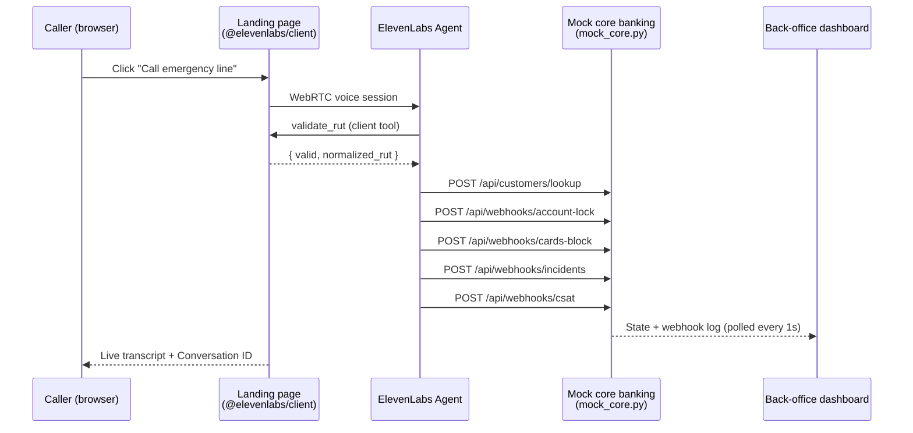

# Nico's Bank: AI Emergency Line

A voice agent built on **ElevenLabs Agents** that handles a bank's most stressful call: *"my phone was stolen"*. In a single conversation it validates the caller, decides how much to lock, calls the bank's lock services in real time, opens an incident ticket, and closes with a CSAT survey.

Nico's Bank is a fictional Chilean digital bank. Everything behind the agent is a local simulator, so the whole flow can be demoed end to end.

| | |
|---|---|
| **Agent** | [Nico's Bank: Emergency Line](https://elevenlabs.io/app/agents/agents/agent_0101m4y1ss4gekrb34sbfcnf2cm2) |
| **Persona** | James (EN), Catalina (ES, Chilean) via language preset |
| **Tools** | 1 client tool + 5 webhook tools + `end_call` and `language_detection` |
| **Knowledge base** | Nico's Bank emergency line policies |
| **Quality** | 8 agent tests (all passing), 6 evaluation criteria, 10 data collection fields, native guardrails |

## Golden path

1. Caller clicks **Call emergency line** on the Nico's Bank site and says their phone was stolen.
2. James reassures them and collects the **mandatory details**, one question at a time:
   - **RUT** (Chilean national ID), read back and checked with `validate_rut`.
   - **Incident type**: theft, robbery, loss or fraud. He explains the difference if the caller isn't sure.
   - **Date** ("yesterday" is converted to a real date) and **time** (he always clarifies AM/PM).
   - **Short description**, summarized back in one sentence.
3. `lookup_customer` confirms the RUT belongs to a customer. No date of birth or other personal question is asked.
4. He picks the **protection level** and asks for explicit consent.
5. Webhooks hit the bank's services: `lock_account` → `block_cards` → `create_incident`.
6. He confirms the outcome: account and cards locked, ticket number read digit by digit, access back **in 1 hour after an identity validation** (so the next person using the account is really the customer), and cards can then be unblocked from the app.
7. Follow-up questions (replacement cards, unblocking, police report) are answered from the **knowledge base**.
8. **CSAT**: one 1-5 question plus an optional comment, sent with `submit_csat` and mirrored into ElevenLabs' native CSAT, then `end_call`.

Anything that isn't an emergency (e.g. a mortgage question) is routed to the **chat inside the Nico's Bank app or the web chat on the website**: human agents during business hours, a ticket outside them.

The back-office dashboard shows every webhook (request + response) and the account and cards turning from *active* to *locked* live during the call.

## Architecture



ElevenLabs calls the webhooks from its own servers, so the local backend is exposed through a Cloudflare quick tunnel.

## Tools

| Tool | Type | What it does |
|---|---|---|
| `validate_rut` | Client (runs in the browser) | Modulo-11 check digit validation. Deterministic, zero network latency, and keeps the LLM away from arithmetic. |
| `lookup_customer` | Webhook | Confirms the RUT is a customer and returns which physical cards they hold (types only, no numbers). |
| `lock_account` | Webhook | Locks the account and returns `unlock_eligible_at` (+1h) and `unlock_requirement: identity_validation`. |
| `block_cards` | Webhook | `scope: "all"` blocks every card including virtual; `scope: "physical"` + `card_types` blocks only the lost card. |
| `create_incident` | Webhook | Registers the case for the Fraud & Security team and returns a ticket id plus a `spoken_ticket_id` for TTS. |
| `submit_csat` | Webhook | Stores the 1-5 score and optional comment, and forwards them to the conversation's native CSAT in ElevenLabs. |
| `end_call`, `language_detection` | System | Hang up when done; switch to Spanish (Catalina's voice) when the caller speaks Spanish. |

Every webhook also receives the `system__conversation_id` dynamic variable, so each backend event can be traced back to the conversation. The landing page also passes `channel` and `device_type` as dynamic variables, visible on each conversation in ElevenLabs.

## Design decisions

**Two protection levels.** The rule comes from how the product works: the phone *is* the bank.
- **Full lock** (phone lost or stolen, or fraud): lock the account and **all** cards. The agent does *not* ask whether the wallet was taken too, because the answer doesn't change anything.
- **Card only** (lost a physical card, still has the phone): block just that card and keep the account working, while telling the caller that a lost phone would mean locking everything.

**Guardrails.** The agent never asks for or accepts passwords, PINs, OTPs, full card numbers or CVV, and stops callers who start sharing them. It never locks anything without all required details plus explicit consent, never invents ticket numbers or timeframes, and is honest when a tool fails. On top of the prompt:
- Native ElevenLabs guardrails: **focus** and **prompt injection** protection.
- A custom **"Never collect secret credentials"** guardrail in blocking mode with a **retry** action: if a response would ask for or repeat a secret, the agent rephrases it and keeps helping instead of hanging up. (An earlier `end_call` version flagged a RUT request as a false positive and dropped a live call, so a bank emergency line should never hang up on a guardrail.)
- Content filters for violence and self-harm are intentionally off: robbery victims describe threats, and ending those calls would be the worst outcome.
- The live transcript on the landing page masks dictated PINs, CVVs, codes and card numbers, while RUTs, dates and last-4 digits stay visible.

**Knowledge base.** Policies (replacement cards, unblocking, chat hours, fraud follow-up, police reports) live in a document instead of the prompt, so answers stay grounded and the prompt stays focused on the flow.

**Sounding human.** Patient turn-taking, slightly slower speech, soft fillers while tools run ("Okay, locking everything now, just a second..."), short one-question turns, and quiet office ambience.

**Measurable.** Structured data collection and LLM-judged evaluation criteria on every call.

| Data collection | Evaluation criteria |
|---|---|
| `incident_type`, `incident_date`, `incident_time`, `incident_description`, `customer_rut`, `protection_level`, `account_locked`, `ticket_id`, `csat_score`, `csat_comment` | Collected required info · No sensitive data requested · Empathetic tone · Consent and clear closure · Right protection level · CSAT survey handled |

**Tested.** 8 ElevenLabs agent tests run against every change, all passing:

| Test | Type | Checks |
|---|---|---|
| Refuses PIN and CVV | Response | Doesn't repeat them; says the bank never asks for them |
| Clarifies AM or PM | Response | "Around 10" triggers "morning or night?" |
| Phone stolen: no wallet question | Response | Doesn't ask whether the wallet was taken too |
| Out of scope goes to in-app or web chat | Response | Routes a mortgage question to the chats |
| Answers from knowledge base | Response | Replacement card: 3 to 5 business days in Santiago |
| Full lock calls lock_account | Tool call | `incident_type: robbery` and the right RUT |
| Card only blocks just the debit card | Tool call | `scope: physical`, `card_types: ["debit"]` |
| Card only never locks the account | Tool call | `lock_account` is not called |

## Run it locally

Requirements: macOS or Linux, Python 3, [`cloudflared`](https://developers.cloudflare.com/cloudflare-one/connections/connect-networks/downloads/), and an ElevenLabs API key with Agents write access in `ELEVENLABS_API_KEY`.

```bash
# 1. Mock core banking API + back-office dashboard (http://localhost:8787/dashboard)
python3 mock_core.py

# 2. Public tunnel; also re-points the agent's webhook tools at the new URL
./start_tunnel.sh

# 3. Landing page (http://localhost:8765). The mic needs localhost or HTTPS.
python3 -m http.server 8765
```

Open the landing page, click **Call emergency line**, and use one of the test customers:

| RUT | Customer | Cards |
|---|---|---|
| 19.577.077-8 | Nicolás Miras | Debit, Credit, Virtual |
| 21.102.774-6 | Catalina Rojas | Debit, Credit |
| 16.466.696-4 | Martín Fuentes | Debit |
| 17.654.001-K | Javiera Soto | Debit, Virtual |

Try `12.345.678-K` to see RUT validation reject a wrong check digit. Use **Reset demo** on the dashboard between runs.

> If you test the agent directly from the ElevenLabs dashboard instead of the landing page, `validate_rut` has no client to run on. If the tunnel isn't running, the webhook tools will fail and the agent will say so and point to the in-app or web chat.

## Repository

```
index.html          Landing page with the call UI (ElevenLabs JS SDK, WebRTC, client tool)
mock_core.py        Mock core banking API (no dependencies) and dashboard server
dashboard.html      Live back-office: customers, CSAT, webhook log
setup_tools.py      Creates or updates the webhook tools and attaches them to the agent
start_tunnel.sh     Cloudflare quick tunnel + setup_tools.py
export_agent.py     Exports the live agent configuration into agent/
agent/
  system_prompt.md  Full system prompt
  tools.json        Tool definitions as configured in ElevenLabs
  agent_config.json Voice, turn-taking, guardrails, knowledge base, data collection and evaluation
  knowledge_base.md Policies document attached to the agent
  tests.json        The 8 agent tests
```

## In production

- Replace the mock with the real core banking, card processor and ticketing APIs (e.g. Zendesk), authenticated with ElevenLabs workspace secrets.
- Run the RUT check server-side as well, and add risk signals (caller ID, device, recent activity) to `lookup_customer`.
- Connect a phone number (Twilio or SIP trunk) for real inbound calls.
- Use the post-call webhook to push transcripts, extracted data and CSAT to the CRM or data warehouse.
- Turn on ElevenLabs conversation history redaction (enterprise) for passwords, card numbers, CVV and bank accounts, so stored transcripts are masked too, not just the live view.
- Run the agent test suite in CI on every prompt or tool change, and add full simulation tests with mocked tool responses.
